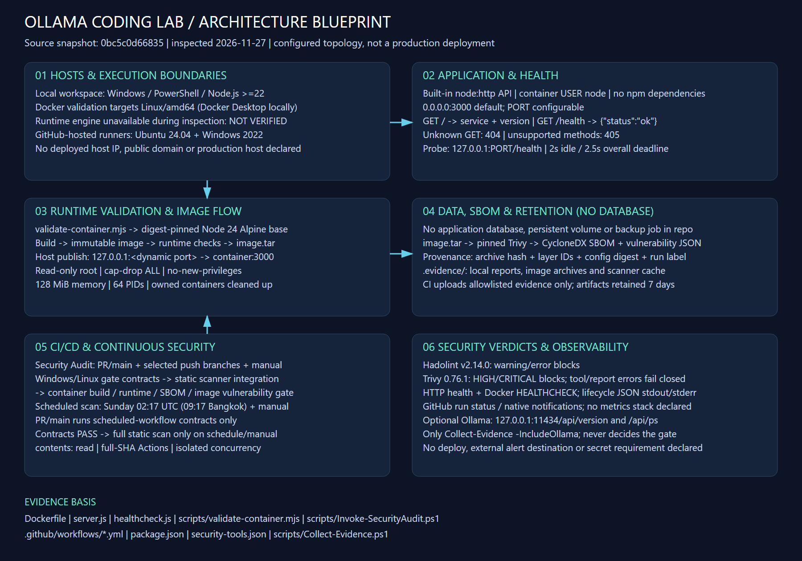
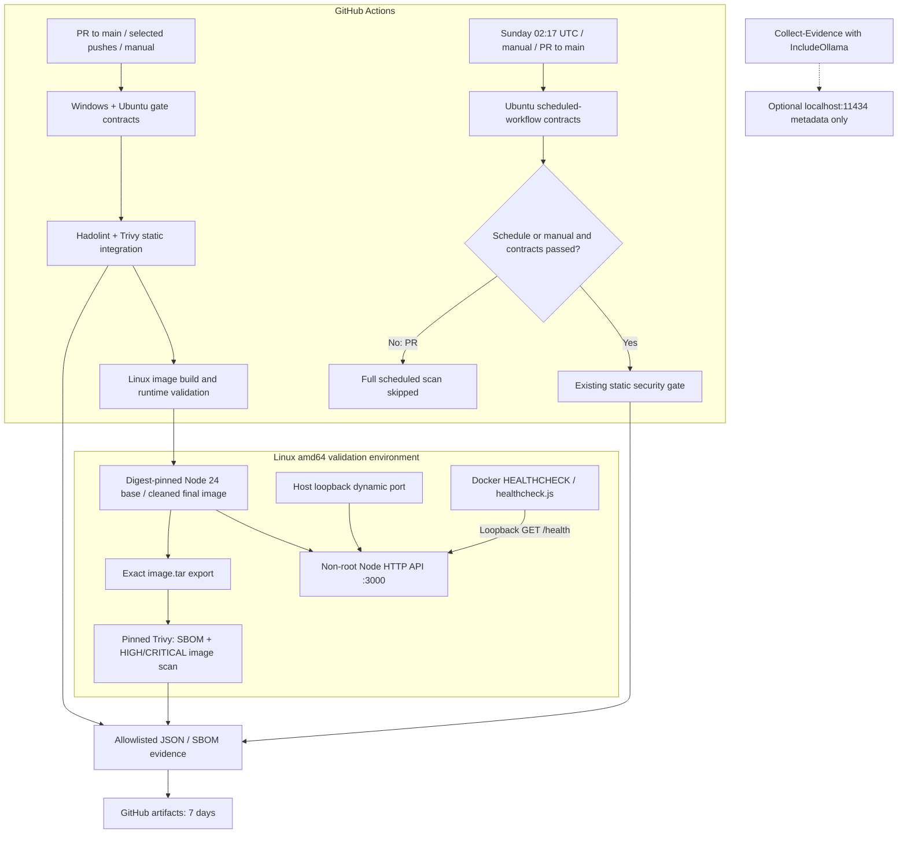

# Architecture grounded in repository evidence

Inspected 2026-11-27 at source commit `0bc5c0d6683598fda1600f8d48bf5ca4ea96d5a2`.
This diagram describes configured execution paths, not a confirmed deployment.
Local Windows workspace was accessible; `docker info` and `docker ps` both failed
because `dockerDesktopLinuxEngine` pipe was absent. Running containers, published
ports and runtime health are therefore **NOT_VERIFIED**. No production host IP or
domain is declared in the inspected configuration. No database, persistent data
volume or application backup pipeline is defined in this repository.



## Components, ports and flows

| Component | Port / interface | Flow and evidence source |
| --- | --- | --- |
| Demo API | `0.0.0.0:3000` by default; `PORT` configurable | `server.js`: `GET /` service/version; `GET /health` returns HTTP 200 and `{"status":"ok"}`. Unknown GET returns 404; unsupported methods 405. No npm dependencies in `package.json`. |
| Local validation publish | `127.0.0.1:<Docker-assigned port>` to container `3000/tcp` | `scripts/validate-container.mjs`: ephemeral validation only; not a fixed public endpoint. |
| Health probe | Container `127.0.0.1:PORT/health` | `healthcheck.js`: fail by default; complete HTTP 200 + valid status required; 2-second inactivity timeout, 2.5-second total deadline, 1024-byte body limit. |
| Docker health scheduling | Internal exec; no extra port | `Dockerfile`: interval 3s, timeout 3s, start period 3s, retries 3; non-root `USER node`. |
| Runtime controls | Docker CLI on host | Validator adds read-only root, cap-drop ALL, no-new-privileges, 128 MiB memory and 64 PIDs; validates kernel state and cleans only its owned containers. These flags are supplied by the validator, not globally enforced by the Dockerfile. |
| Static security gate | Docker CLI; registry/database network access | `Invoke-SecurityAudit.ps1`: Hadolint warnings/errors block; Trivy HIGH/CRITICAL vulnerabilities/misconfigurations block; operational/report/exit inconsistencies fail closed. Scanner identities are digest pinned in `security-tools.json`. |
| Image supply chain | Read-only image archive input; writable per-run cache | Validator exports immutable image, produces CycloneDX SBOM and vulnerability JSON; checks archive SHA256, layer DiffIDs, config digest and ownership label. No scanner Docker socket mount. |
| Security Audit workflow | GitHub events; no app ingress | `.github/workflows/security-audit.yml`: PRs targeting main, main/selected feature pushes, manual. Windows 2022/PowerShell and Ubuntu 24.04/pwsh contract jobs precede static and runtime jobs. |
| Scheduled workflow | Sunday `17 2 * * 0` UTC / manual / PR main | `.github/workflows/scheduled-security-scan.yml`: PR runs workflow contracts only; schedule/manual scan requires contracts success. Separate concurrency group, `contents: read`, full-SHA Actions. |
| Evidence storage | Local `.evidence/` and GitHub artifacts | Local image archives/cache retained for inspection; CI allowlists JSON/SBOM reports and retains artifacts 7 days. Image archives/cache are not uploaded. This is evidence retention, not application backup. |
| Observability | `/health`, Docker health, stdout/stderr, GitHub status | `server.js` emits lifecycle JSON events; no metrics endpoint, log collector or external alert destination is configured. Native GitHub notifications depend on user settings. |
| Optional Ollama | `127.0.0.1:11434/api/version`, `/api/ps` | `Collect-Evidence.ps1 -IncludeOllama` collects metadata only. Workflows do not enable it; it never determines security verdicts. Availability was not probed in this inspection. |

## Blueprint source and reproduction

[SVG](assets/architecture.svg) and [self-contained HTML](assets/architecture.html)
are committed with the PNG. The PNG was rendered using Microsoft Edge Headless,
not an image generation model, at **1800 x 1260 pixels**. It was opened and visually
reviewed: section boundaries, text, ports and labels fit without overlap or clipping.

From the repository root in PowerShell (adjust Edge location if necessary):

```powershell
$blueprintRoot = (Get-Location).Path
$blueprintHtml = ([Uri](Join-Path $blueprintRoot 'docs/assets/architecture.html')).AbsoluteUri
$blueprintPng = Join-Path $blueprintRoot 'docs/assets/architecture.png'
& 'C:\Program Files (x86)\Microsoft\Edge\Application\msedge.exe' --headless --disable-gpu --no-first-run --hide-scrollbars --window-size=1800,1260 "--screenshot=$blueprintPng" $blueprintHtml
```

Update both SVG and the inline SVG in HTML when revising the drawing, rerender,
and inspect the PNG before publishing. This documentation change deploys no service
and does not change runtime, scanner policy or CI. Rollback through a reviewed
documentation revert; no Docker cleanup or data restoration is required.
